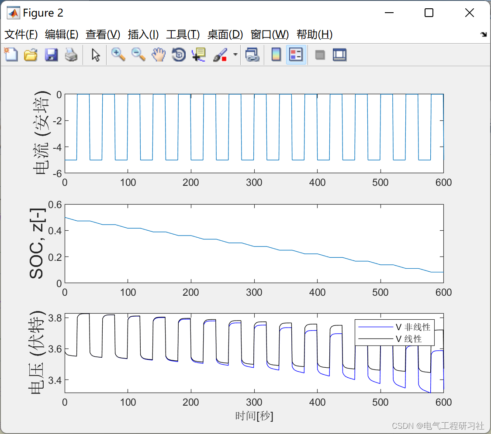
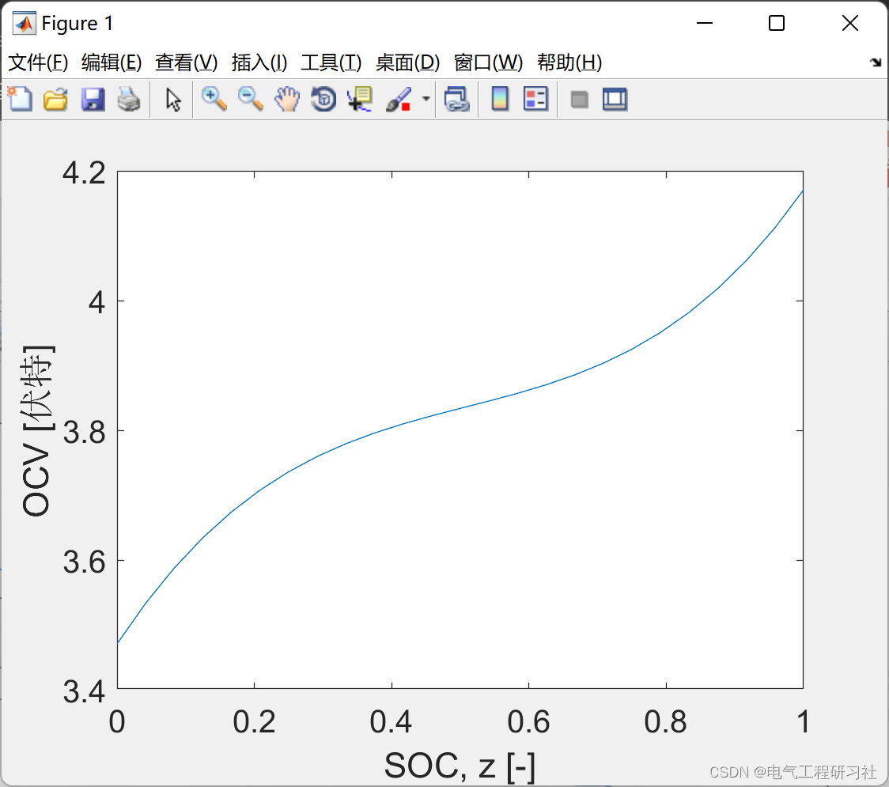
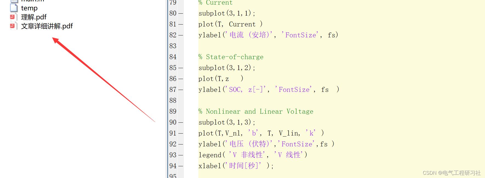

# Battery Modeling, Analysis and Optimization (Matlab Code Implementation)

​  
1. Overview of the past few years has seen many issues emerge, stimulating interest in developing smart grids. Among these, some are growing due to the increasing carbon emissions and uncertainties associated with fossil fuels, driving the market for electric transportation. Additionally, there is a growing demand for high-quality electricity without interruptions, which must be transported without loss. All these factors have created a need for smart grids. Modeling, control, optimization, and modeling will be used to integrate technologies that enable this smart grid to function. The smart grid will be driven by network infrastructure, where power flow is facilitated through wide area sensing, advanced communication, control, and distributed drive. All current problems with the power grid and sustainable energy are hidden behind control issues. This paper presents examples of active power control for batteries, coordinated control of variable generation using FACTS, and reactive power control using distributed renewable energy sources.
2 Mathematical Models
1. Analysis: Simulation or prediction. Given the current future trajectory of u(t), x(0), and the system model σ, predict y(t). 2. State Estimation: Given a system σ(t) with time history u(t) and y, find x that is consistent with σ,u,y. This is the issue with monitoring. In other words, it is not possible to measure each state, but it is hoped that each state can be monitored. 3. System Design or Planning: Given u(t) and some desired y(t), find σ such that u(t) applied to the system will produce y(t). Most engineering disciplines deal with design synthesis. Traditionally, people might create various physical prototypes to synthesize the required system. 4. Model identification: Given the time series u(t) and y(t), typically obtained from experimental data, determine the model that matches u and y as well as its parameter values. 5. Control integration. Given a system with current state x(0) and some desired states y(t), find u(t) such that the system will produce y(t). Energy management issues.
Detailed mathematical models and explanations are provided in Part 5.
3. Stability and linearization
The rest of the content is available in Section 5.
4 Simulation Results and Analysis
Editor
When the OCV stabilizes and then decreases, the linearized version will deviate from its path. Due to changes in the direction of the second derivative, the linear model produces errors, which only consider the first derivative. The OCV changes from an upward curve to a downward one. The linearized model can only help us estimate the system at certain points. It is evident that there will be errors when the OCV changes direction and the second derivative.
5 Matlab Code and Article Explanation
This article only showcases part of the code, with all the code available in:
Editor

## Images

<!-- PAYMENT_BLOCK -->

## Get this dataset

- Payment link (Stripe): [Buy now](https://buy.stripe.com/3cs8yP7sY87d0vu9AB)
- Payment QR code: 

<!-- /PAYMENT_BLOCK -->
